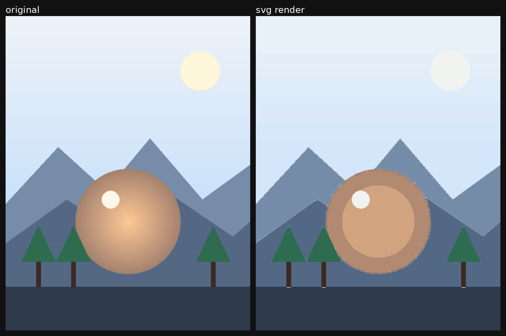

# image-to-svg-trace

[English](README.en.md) ｜ **中文**

**把任意位图变成真正的 SVG——不依赖 numpy、不用 vtracer，一个文件，五秒出图。**

---

## 这是什么

只用 Pillow 写成的位图转矢量工具，没有任何额外依赖。

流程：预处理 → 调色板减色 → 像素边界追踪（crack following）→ 折线简化（Douglas–Peucker）→ 输出 SVG `<path>`

输出按面积降序叠层，用 `fill-rule="evenodd"` 处理镂空，最终是一个自包含、可无限缩放的 SVG，能直接拖进 Illustrator / Figma / Inkscape。



*左：输入的位图。右：从生成的 SVG 重新渲染。这一对的 MAE 是 **1.83**（逐像素平均绝对误差，0–255）。*

## 为什么不用 vtracer / potrace / autotrace

在 WSL2 + Python 3.14 上实测（2026 年 10 月）：

| 工具 | 结果 |
|---|---|
| `vtracer` 0.6.15 / 0.6.11 | 能导入，第一次调用就**段错误**——连 60×107 的小图也一样。wheel 和环境不匹配。 |
| `potracer` | 装完报 `ModuleNotFoundError: No module named 'potrace'`；还要拖进 numpy（16.7 MB） |
| `potrace` / `autotrace` 二进制 | 系统里没有，这个发行版也没打包 |

所以就自己写了一个两百来行、只用 Pillow 的实现。你在哪都能跑，不用装编译器、不用配原生库。

## 安装

```bash
pip install pillow
git clone https://github.com/SSSY418/image-to-svg-trace.git
cd image-to-svg-trace
```

没有其他依赖。Python 3.9+。

## 用法

```bash
# 默认：宽 675、48 色、保真优先
python3 scripts/img2svg.py input.jpg output.svg

# 保真优先（插画推荐从这个配方起步）
python3 scripts/img2svg.py input.jpg output.svg \
  --width 675 --colors 48 --eps 0.45 --min-area 20 \
  --saturate 1.25 --median 3

# 小文件、干净色块
python3 scripts/img2svg.py input.jpg output.svg \
  --colors 20 --eps 0.8 --min-area 60 --smooth 1
```

运行完输出一行：

```
done output.svg  2882660 bytes  48 layers  675x1204
```

| 参数 | 默认值 | 作用 | 调大 | 调小 |
|---|---|---|---|---|
| `--width` | 675 | 输出画布宽度（高度按比例） | 细节更多，文件更大 | 更快，更粗 |
| `--colors` | 48 | 调色板色数（median-cut，不抖动） | 更接近原图，色阶更多 | 更平，可能丢高光 |
| `--eps` | 0.45 | Douglas–Peucker 容差，单位像素 | 节点更少，边缘更硬 | 更贴像素，文件更大 |
| `--min-area` | 20 | 丢掉小于这么多平方像素的区域 | 更干净，丢小细节 | 保留细节，可能发噪 |
| `--median` | 3 | 预模糊，压 JPEG 噪点 | 更干净，更柔 | 保留颗粒 |
| `--saturate` | 1.25 | 饱和度补偿（减色会把画面变灰） | 更艳 | 更淡 |
| `--smooth` | 0 | 减色后做一次 3×3 众数滤波 | 干净很多，会吃掉细线和眼睛高光 | 保留细节 |
| `--contrast` | 1.0 | 对比度补偿 | 更冲 | 更平 |
| `--bg` | `#ffffff` | 垫在最底下的背景色 | | |

经验值：

- **动漫 / 扁平插画**：`--colors 40~48 --eps 0.4~0.5 --min-area 15~25 --saturate 1.25`
- **照片**：`--colors 64 --eps 0.35 --median 3`
- **图标 / 线稿**：别用这个工具，要用中心线（centreline）描摹
- **大色块、小文件**：`--colors 16~24 --eps 0.8 --min-area 60 --smooth 1`

## 在 LLM 生图流程里的位置

生图模型交出来的是位图：一放大就糊，也不能按形状改色。这个工具就是生成之后的那一步——把模型的输出喂进去，五秒在 CPU 上拿到一个自包含的 SVG，不占 GPU、不联网、也不需要模型权重。

两个具体用法：批量后处理，一批图出完统一转矢量，拿去做印刷、图标、UI 素材；以及可复现的素材管理，SVG 在 git 里能 diff、在哪儿渲染都一样，采样出来的 PNG 两样都做不到。

一句提醒：它只把生成结果矢量化，不会修正模型画错的东西；40~48 色也会把渐变压平，限制见下一节。

## 验证闭环

只描不验等于猜。`scripts/render_check.py` 用无头 Chrome 把 SVG 渲染回位图，算出和原图的像素差，顺手生成一张左右对比图。

```bash
python3 scripts/render_check.py examples/demo-output.svg \
  --ref examples/demo-input.png \
  --out examples/demo-render.png \
  --compare examples/demo-compare.png
```

```json
{
  "svg": "examples/demo-output.svg",
  "size": [560.0, 720.0],
  "chrome": "/mnt/c/Program Files/Google/Chrome/Application/chrome.exe",
  "png": "examples/demo-render.png",
  "px": [560, 720],
  "mae": 1.83,
  "compare": "examples/demo-compare.png"
}
```

`mae` 是逐像素平均绝对误差，0–255，按 RGB 平均。越低越接近。

参考量级：

| 做法 | MAE |
|---|---|
| 这个工具，默认参数，插画 | **7.0** |
| 这个工具，扁平矢量风 demo | **1.8** |
| 手写 SVG 坐标「复刻」插画 | **76.8** |

最后一行就是这工具存在的理由：手写坐标复刻插画，四版加起来 MAE 76.8，换上描摹第一版就是 7.0。能描就别手摆坐标。

## 输出特性与局限

先说实话，别等用户问：

- **输出是折线不是曲线**，放大四倍能看出多边形边。要更顺就做 Catmull-Rom → 贝塞尔拟合。
- **细节会被压平**：高光、渐变、柔光都变成色块，20~48 色下色阶不可避免。
- **文件偏大**：675 宽 48 色大约 2.5–3.5MB，细节多的图更狠，这是保真的代价。
- **这是描摹不是重绘**：形状是机器切的色区，不是画师那套结构，手改起来很别扭。
- **文字会变成糊块**：能重新打字就别描截图。

## 作为 OpenClaw skill 使用

仓库里的 `SKILL.md` 是同一套流程的 agent 版说明书，放进 skills 目录即可让 agent 在「把这张图转成 svg」时自动走这套流程。

## 目录

```
img2svg.py   → scripts/img2svg.py     描摹器本体
render_check.py → scripts/render_check.py   渲染 + MAE + 对比图
SKILL.md                              agent 用的流程说明
examples/                             demo 的输入、输出、渲染图、对比图
```

## 许可证

MIT © 2026 SSSY418，见 [LICENSE](LICENSE)。

描摹产物是输入图的衍生品：源图你能怎么用，描摹结果才能怎么用；源图的授权限制，同样落在结果上。
